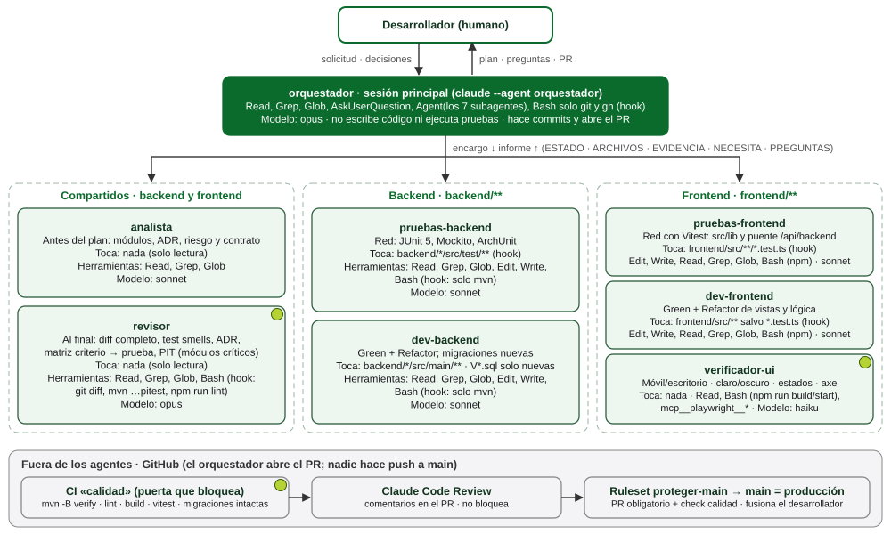
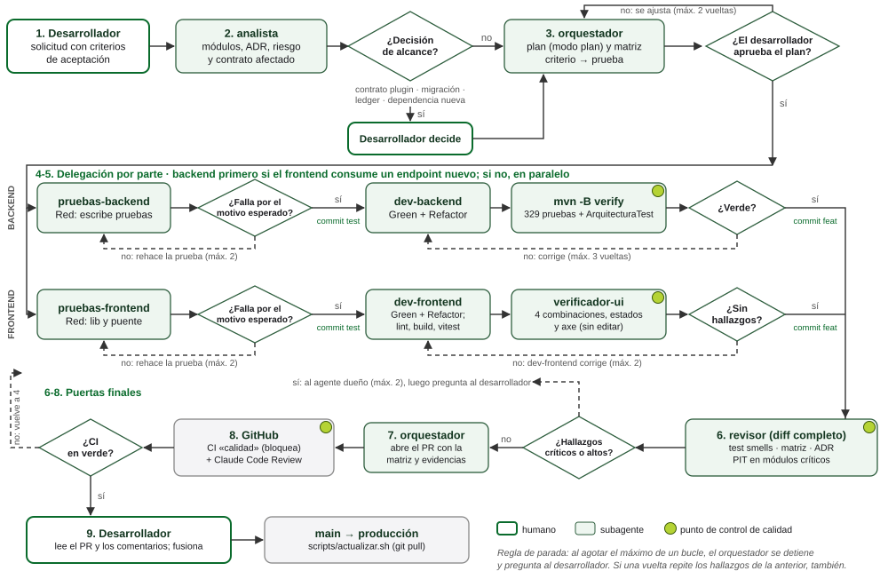

# Sistema de agentes de LatinosMC

Sistema de agentes de **Claude Code** para el backend y el frontend de este
monorepo, centrado en una pregunta: **cómo se impide que llegue a `main` código
incorrecto escrito por la IA**, sabiendo que `scripts/actualizar.sh` despliega
lo que hay en `main`.

El diseño original, con la tabla de agentes, la calidad y las diferencias con
el sistema de referencia del diplomado, es
[Taller-Sistema-de-Agentes-Jhon-Oliveros.pdf](Taller-Sistema-de-Agentes-Jhon-Oliveros.pdf).
Este README describe lo que está **implementado**.

## Dónde está cada cosa

| Pieza | Ubicación |
|---|---|
| Los ocho agentes | [`.claude/agents/`](../../.claude/agents/) |
| La política de permisos (qué carpetas y qué comandos tiene cada rol) | [`.claude/hooks/politica.mjs`](../../.claude/hooks/politica.mjs) |
| Los hooks que la aplican | [`limitar-rutas.mjs`](../../.claude/hooks/limitar-rutas.mjs) y [`limitar-bash.mjs`](../../.claude/hooks/limitar-bash.mjs) |
| Las pruebas de la política | [`politica.test.mjs`](../../.claude/hooks/politica.test.mjs), en la CI (trabajo `arnes`) |

## Los agentes

Es un sistema único para el monorepo, con agentes limitados a `backend/**` o a
`frontend/**`.

| Agente | Parte | Hace | Puede editar | Puede ejecutar | Modelo |
|---|---|---|---|---|---|
| `orquestador` | ambas | Escribe la spec, el plan y las tareas; coordina; hace los commits y abre el PR | `specs/NNN-*/{spec,plan,tareas,pr}.md` y los ADR | `git` y `gh` de su lista; nunca `main` ni fusionar | opus |
| `analista` | ambas | Mapa del cambio: módulos, riesgo, ADR y contrato | Nada | Nada | sonnet |
| `pruebas-backend` | backend | Rojo con JUnit 5, Mockito y ArchUnit | `backend/*/src/test/**` | `mvn ... test\|verify` | sonnet |
| `dev-backend` | backend | Verde y refactor; migraciones nuevas | `backend/*/src/main/**`, salvo `application*.yml` y migraciones que ya están en `main` | `mvn ... compile\|test\|verify` | sonnet |
| `pruebas-frontend` | frontend | Rojo con Vitest para `src/lib` y el puente | `frontend/src/**/*.test.ts` | `npm run test` | sonnet |
| `dev-frontend` | frontend | Vistas y lógica | `frontend/src/**` salvo pruebas, y `frontend/public/**` | `npm ci`, `npm run lint\|test\|build` | sonnet |
| `verificador-ui` | frontend | Mira la pantalla real: móvil y escritorio, claro y oscuro, estados, consola y accesibilidad | Nada | `npm run build\|start` y el navegador (Playwright MCP) | haiku |
| `revisor` | ambas | Pruebas débiles, matriz criterio → prueba, reglas, contrato y mutación | Nada | `git diff\|log`, `npm run lint\|test`, PIT | opus |





Los diagramas son los del diseño. Lo que cambió al implementarlo está en la
sección siguiente.

## Cómo se usa

Desde la **raíz del repositorio** (los hooks se localizan con
`CLAUDE_PROJECT_DIR`, que es la carpeta donde arranca la sesión):

```powershell
claude --agent orquestador
```

Y se le pide la funcionalidad. El orquestador sigue este orden y se detiene a
preguntar en los pasos marcados:

1. Spec (`spec-sdd`) → **aprobación del desarrollador**.
2. `analista` → si hay una parada obligatoria (contrato del plugin, migración,
   ledger o dependencia nueva), **pregunta**.
3. Plan y tareas → **aprobación del desarrollador**. Commit `docs(specs)`.
4. `pruebas-backend` / `pruebas-frontend` → rojo confirmado. Commit `test(...)`.
5. `dev-backend` / `dev-frontend` → verde. `verificador-ui` si hay pantalla.
   Commit `feat(...)`.
6. `revisor` sobre el diff completo. Un hallazgo alto impide abrir el PR.
7. Push de la rama y pull request. **La fusión la hace el desarrollador.**

Cada bucle de corrección tiene un máximo de 3 vueltas.

## Cómo se hacen cumplir los permisos

El campo `tools` de un agente decide qué herramientas tiene, pero no sobre qué
carpetas las usa. Eso lo deciden dos hooks `PreToolUse` declarados en el
frontmatter de cada agente, que leen la llamada y salen con código 2 si no
cumple la política. Es una restricción, no una instrucción: aunque el modelo
ignore su prompt, la herramienta no se ejecuta.

- Si el hook no puede decidir (entrada ilegible, error interno), **bloquea**.
- Un comando compuesto se parte en segmentos y todos tienen que estar
  permitidos: `mvn verify && git push origin main` se rechaza entero.
- Se rechaza cualquier comando con `$(...)`, comillas invertidas o
  redirecciones, porque no se puede saber qué ejecutaría.
- `.claude/settings.json` niega además, para toda sesión, leer `.env`, editar la
  configuración de producción, hacer push a `main` y fusionar un PR.

Para comprobar la política: `node --test .claude/hooks/`.

## Cambios respecto del diseño del taller

Los que se decidieron al implementarlo. Los que salgan del uso real en las specs
se agregan aquí con lo observado.

| # | Diseño del taller | Implementado | Por qué |
|---|---|---|---|
| 1 | El `orquestador` no tenía `Edit` ni `Write` | Puede escribir, y solo ahí, los documentos de `specs/NNN-*/` y los ADR | El diseño decía que no había `spec.md` ni `tasks.md`. El proyecto ahora trabaja con SDD, y alguien tiene que escribir la spec, el plan y las tareas. Se le dio al único agente que habla con el desarrollador, limitado por hook para que siga sin poder tocar código. |
| 2 | Los hooks se describían como scripts de shell | Son scripts de Node con una política central y pruebas | El equipo trabaja en Windows y la CI en Linux: Node ya es requisito del frontend y se comporta igual en los dos. Al centralizar la política en un archivo se la pudo probar (26 pruebas). |
| 3 | `verificador-ui` usaba axe-core | Revisa la accesibilidad con una lista sobre el árbol de accesibilidad que da Playwright | axe-core sería otra dependencia nueva y el servidor MCP de Playwright no lo incluye. Es un control más débil que axe: queda anotado como límite. |
| 4 | El `revisor` podía ejecutar `mvn ... pitest` siempre | Solo si el diff toca un módulo crítico y el perfil de mutación existe | PIT todavía no está configurado en el `pom.xml`; llega en un pull request aparte. |
| 5 | La lista `Agent(...)` limitaba a quién llama cada agente | Solo limita al `orquestador`, y solo si corre como agente principal | Es como funciona Claude Code: la lista entre paréntesis se aplica al agente de `--agent`. Los subagentes no tienen la herramienta `Agent`, así que no se llaman entre sí. |

## Lo que el sistema no alcanza

- **Lo que se haga sin los agentes.** Los hooks solo actúan en una sesión de
  Claude Code que use estos agentes. Quien trabaje a mano solo encuentra la CI y
  el ruleset `proteger-main`.
- **SQL que nunca se ejecutó.** Ninguna prueba usa PostgreSQL real (ADR-0021).
- **Un criterio de aceptación equivocado.** El sistema prueba lo que se pidió.
- **Componentes React.** Solo la lógica y el puente tienen pruebas (ADR-0031).
