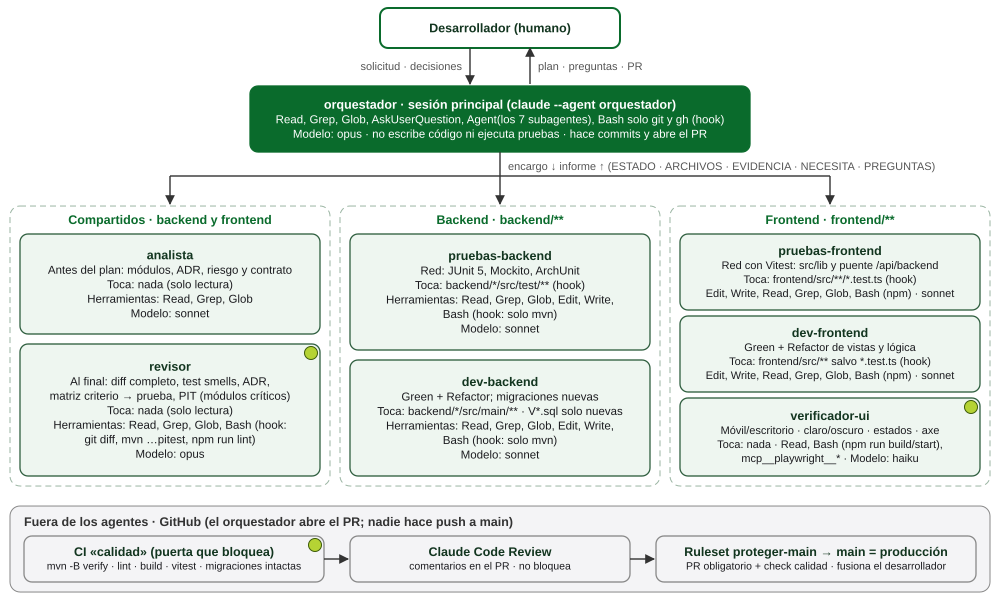
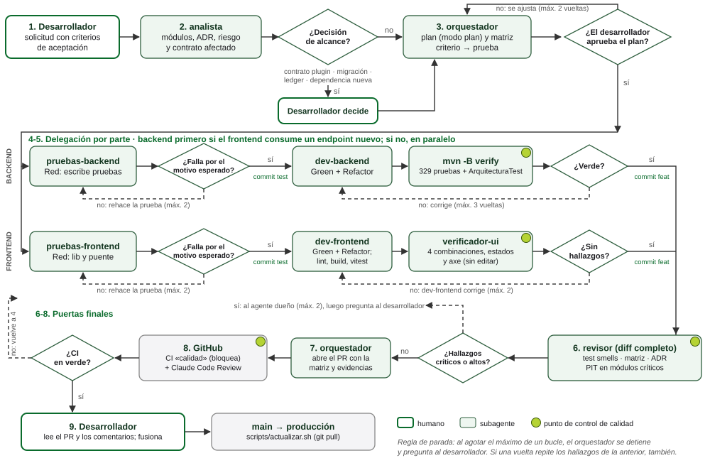

# Sistema de agentes de LatinosMC (diseño)

Diseño de un sistema de agentes de **Claude Code** para el backend y el frontend
de este monorepo, centrado en una pregunta: **cómo se impide que llegue a `main`
código incorrecto escrito por la IA**, sabiendo que `scripts/actualizar.sh`
despliega lo que hay en `main`.

Es un **diseño**: aquí no están los archivos de `.claude/agents/` ni los hooks.
El documento completo, con la tabla de agentes, la calidad y las diferencias
con el sistema de referencia del diplomado, es
[Taller-Sistema-de-Agentes-Jhon-Oliveros.pdf](Taller-Sistema-de-Agentes-Jhon-Oliveros.pdf).

## Resumen

Es un sistema único para el monorepo, con agentes limitados a `backend/**` o a
`frontend/**`. Los permisos de carpeta y de comandos se hacen cumplir con hooks
`PreToolUse` en el frontmatter de cada agente, no con instrucciones.

| Agente | Parte | Hace | Puede tocar | Modelo |
|---|---|---|---|---|
| `orquestador` | ambas | Coordina, pregunta al desarrollador, hace commits por bloque y abre el PR | Nada (solo `git` y `gh`) | opus |
| `analista` | ambas | Antes del plan: módulos, riesgo, ADR que aplican y contrato afectado | Nada | sonnet |
| `pruebas-backend` | backend | Red con JUnit 5, Mockito y ArchUnit | `backend/*/src/test/**` | sonnet |
| `dev-backend` | backend | Green y Refactor; migraciones Flyway nuevas | `backend/*/src/main/**` | sonnet |
| `pruebas-frontend` | frontend | Red con Vitest para `src/lib` y el puente `/api/backend` | `frontend/src/**/*.test.ts` | sonnet |
| `dev-frontend` | frontend | Green y Refactor de vistas y lógica | `frontend/src/**` salvo pruebas | sonnet |
| `verificador-ui` | frontend | Revisa móvil y escritorio, tema claro y oscuro, estados y axe | Nada | haiku |
| `revisor` | ambas | Test smells, matriz criterio→prueba, ADR y mutación PIT en módulos críticos | Nada | opus |

## Qué incorporaría este diseño

Hoy el repositorio ya tiene:

- la CI: `mvn -B verify` en el backend, y `lint` y `build` en el frontend;
- Claude Code Review en cada PR;
- desde el 09/11/2026, el ruleset **`proteger-main`**. Exige PR (nadie hace
  push directo a `main`) y que pasen los checks `cambios`, `backend` y
  `frontend`. También bloquea el borrado y el force push de `main`, y no tiene
  excepciones.

Este diseño agrega:

- los hooks de permisos de cada agente;
- Vitest en el frontend (es una dependencia nueva, así que pasa por un ADR);
- PIT y JaCoCo en el backend;
- un job de CI que falla si se edita una migración ya aplicada. Se agregará a
  los checks obligatorios del ruleset.
